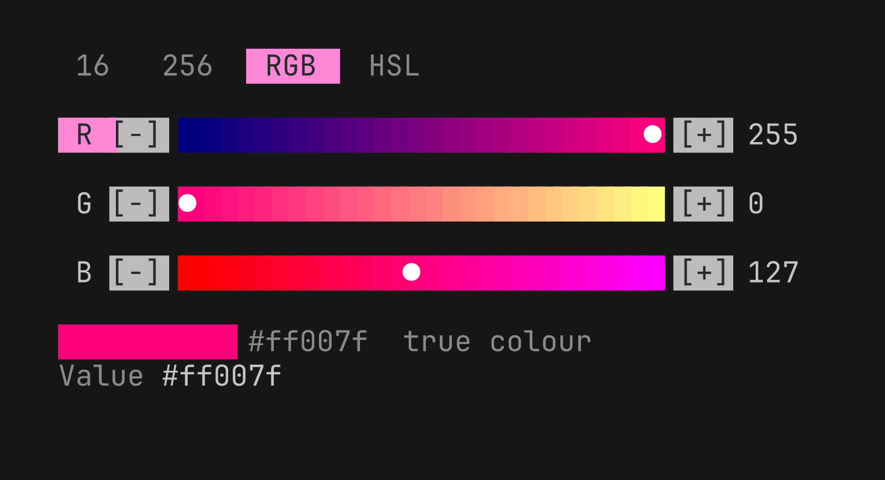

# colourpicker

A colour picker for [Bubble Tea](https://github.com/charmbracelet/bubbletea) v2 programs. Tabs for the 16 and
256 terminal palettes (swatches) and for RGB and HSL (gradient sliders), a preview and the chosen value, with
the keyboard and the mouse. It is the colour dialog of [Cuppa](https://github.com/meta-ui-labs/cuppa), as a
component you can drop into any program.



```sh
go get github.com/meta-ui-labs/cuppa/packages/components/colourpicker
```

## Use

```go
import colourpicker "github.com/meta-ui-labs/cuppa/packages/components/colourpicker"

picker := colourpicker.New(
    colourpicker.WithValue("#ff007f"),         // "", a palette number such as "212", or #rrggbb
    colourpicker.WithTabs("16", "RGB", "HSL"), // which tabs, in order (default: all four)
    colourpicker.WithOrigin(2, 4),             // where it is drawn, so mouse clicks line up
)

// In Update, forward the messages you want it to see:
picker, cmd = picker.Update(msg)
// A change arrives as colourpicker.ChangedMsg{Value: "#ff0080"} (or read picker.Value()).

// In View:
picker.View() // a string, picker.Width() columns by picker.Height() lines
```

A runnable program is in [`examples/basic`](examples/basic).

### Keys and mouse

| Input | Does |
|---|---|
| `tab`, `shift+tab` | next and previous tab |
| arrows on 16 and 256 | move to the neighbouring swatch |
| `up`, `down` on RGB and HSL | choose a slider |
| `left`, `right` on RGB and HSL | change it by one (`shift`: ten) |
| click | a tab, a swatch, `[-]` or `[+]`, or a point on a bar |
| press and drag | along a bar |

### Size

The picker is 46 cells wide. The 16, RGB and HSL tabs are 10 lines; the 256 tab needs 23, so a program with
little room leaves it out: `WithTabs("16", "RGB", "HSL")`.

### Options and methods

| | |
|---|---|
| `New(opts...)` | `WithValue`, `WithTabs`, `WithTab`, `WithAccent`, `WithOrigin` |
| `Value()`, `SetValue(v)` | the colour; a bad value is ignored |
| `Hex()` | the colour as `#rrggbb` even when the value is a palette number |
| `Tab()`, `SetTab(t)`, `Tabs()` | the tab shown and the tabs available |
| `Slide()`, `SetSlide(i)` | the slider the keyboard is on |
| `SetAccent(c)`, `SetOrigin(x, y)` | the accent colour; where it is drawn |
| `Init`, `Update`, `View` | the Bubble Tea shape; `Update` returns a command that produces `ChangedMsg` |
| `Width()`, `Height()` | the size of what `View` draws |

## Not in it (yet)

The *Themes* tab of Cuppa's dialog (342 terminal colour schemes) and typing a value into the picker.

## For tools: `cuppa.component.json`

The repository carries a machine-readable description of the component, so that a design tool can list it,
show its properties and generate the Go that uses it. The format is the *Cuppa component description*
([spec](https://github.com/meta-ui-labs/cuppa/blob/main/docs/spec/cuppa-component.md)): name, Go import path,
how to construct it, its properties with their defaults, and the messages it sends. A repository that
publishes one can be imported into Cuppa by its address.

## Licence

MIT.
