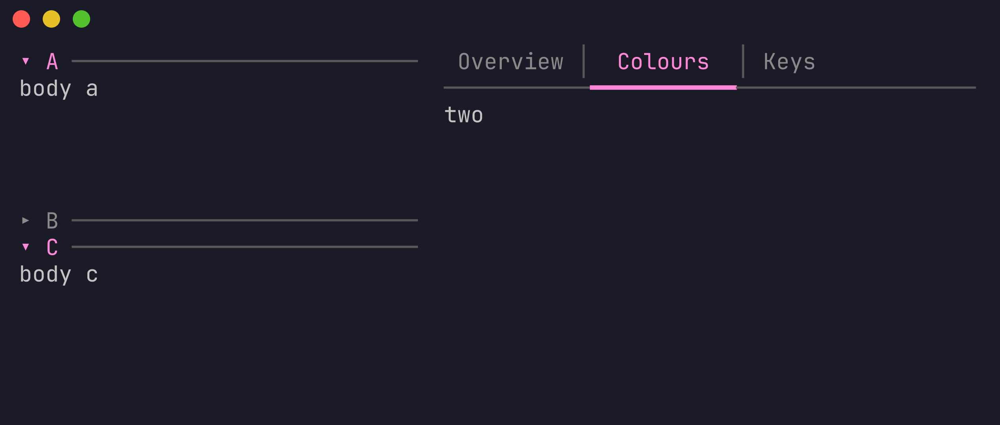

# panels

Collapsible sections and tab pages for [Bubble Tea](https://github.com/charmbracelet/bubbletea) v2
programs. The pages hold content, and pressing a header or a tab shows or hides it with no code of your own,
with the mouse or the keyboard. It is the *Panels* and *Tab pages* of [Cuppa](https://github.com/meta-ui-labs/cuppa),
as a component you can drop into any program.



```sh
go get github.com/meta-ui-labs/cuppa/packages/components/panels
```

## Use

```go
import panels "github.com/meta-ui-labs/cuppa/packages/components/panels"

stack := panels.New(
    panels.WithPages(
        panels.Page{Title: "Details", Body: details}, // Body is func(w, h int) string
        panels.Page{Title: "Layers", Body: layers},
    ),
    panels.WithOpen(0),          // the sections that start open
    panels.WithExclusive(false), // true: opening one closes the others (an accordion)
    panels.WithSize(40, 16),
    panels.WithOrigin(2, 4),     // where it is drawn, so mouse clicks line up
)

tabs := panels.New(panels.WithMode(panels.Tabs), panels.WithPages(...), panels.WithActive(1))

// In Update, forward the messages you want it to see:
stack, cmd = stack.Update(msg)
// A change arrives as panels.ChangedMsg{Active, Open}, or read stack.Open(i) / tabs.Active().

// In View:
stack.View() // a string, stack.Width() columns by stack.Height() lines
```

A body is a function of the room it is given, so a page can hold any view: a Bubbles model's `View`, a list
of lines. `Layout()` says where each page's body is if you place content yourself.

A runnable program is in [`examples/basic`](examples/basic).

### Keys and mouse

| Input | Does |
|---|---|
| click a header or a tab | opens or closes the section, shows the tab |
| `left`, `right` | previous and next tab |
| `up`, `down` | move between sections |
| `enter`, `space` | open or close the section the keyboard is on |

### How the room is shared

*Sections:* one header row per page; the rows left after the headers are shared by the open sections, the last
open one taking the remainder. *Tabs:* the names on the first row and a rule under them; every page's body is
the rest. The arithmetic is the same as Cuppa's designer and exported programs, with the same test numbers.

### Options and methods

| | |
|---|---|
| `New(opts...)` | `WithMode`, `WithPages`, `WithActive`, `WithOpen`, `WithExclusive`, `WithSize`, `WithOrigin`, `WithColours` |
| `Active()`, `SetActive(i)` | the tab shown |
| `Open(i)`, `OpenSections()`, `SetOpen(i, open)` | the open sections |
| `Press(i)` | what pressing page i's header does |
| `Layout()`, `HeaderAt(x, y)` | geometry and hit testing |
| `SetBody(i, fn)`, `SetSize`, `SetOrigin`, `SetAccent`, `SetMuted`, `SetRule` | change it later |

## With Cuppa

`cuppa.component.json` describes the component for design tools: `cuppa component check .` lists what is
wrong with it, and Cuppa's palette can list and export it from its address.

## Licence

MIT
